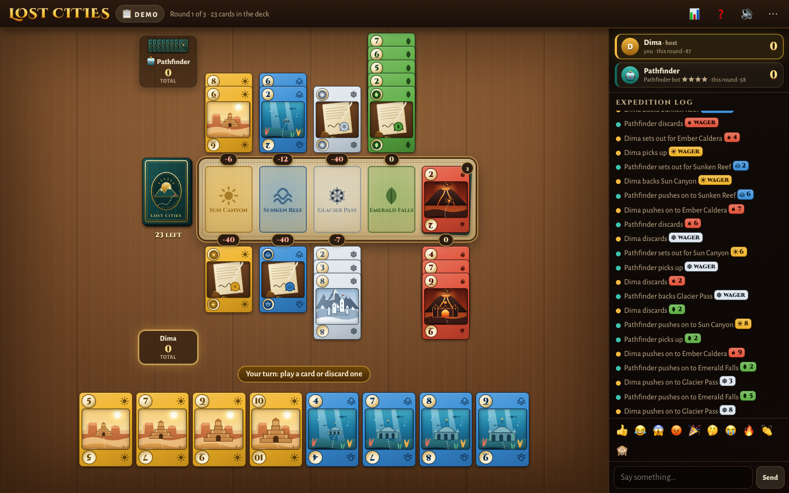

# Lost Cities — online

A two-player card game of daring journeys, in the browser. One person runs a small Python server, the other just
opens a link. Fund five expeditions, push each one deeper with ever higher cards, back the promising ones with
wagers — and don't start what you can't finish. Bots can take the other seat.



## Features

- **The full two-player rules**: 60 cards (five sites × three wager cards + numbers 2–10), 8-card hands,
  play-then-draw turns, ascending expeditions, wagers before numbers, no taking back the card you just discarded,
  the round ends with the last card of the deck, −20 per expedition, wager multipliers and +20 for 8+ cards.
  Matches of 1–5 rounds (3 by default); the round winner starts the next round.
- **A table that looks the part**: a wooden table, a canvas camp board with the five discard piles in the middle,
  your expeditions fanned out below it and your rival's above, original painted-style card art where the lost city
  comes closer as the value rises, and cards that fly between hand, table and piles.
- **Live scoring**: every expedition shows what it would score right now; selecting a card previews the change;
  each round ends with a full breakdown, both hands revealed.
- **Play a friend or a bot**: invite over your Wi-Fi or with a public link. Players can reconnect, move their seat to
  another device, or hand it to the autopilot if they drop out. Spectators welcome.
- **Table extras**: chat and emoji reactions, synthesised sounds, hints, an optional turn timer, optional "look
  through the discard piles", keyboard controls, drag and drop, phone layout.
- **Fair play**: the server holds the game state and checks every move. Your hand and the card you draw from the
  deck are never sent to your opponent.

## Requirements

- [uv](https://docs.astral.sh/uv/getting-started/installation/). It installs Python 3.12 and all dependencies.
- Optional: [cloudflared](https://developers.cloudflare.com/cloudflare-one/connections/connect-networks/downloads/),
  to invite someone from outside your network (`brew install cloudflared` on macOS).

## Quick start

```bash
uv run lostcities serve
```

Open <http://localhost:8000>, click **Create a table**, then either send the invite link to a friend or add a bot,
and click **Set out!**

| Command | Who can join |
| --- | --- |
| `uv run lostcities serve` | People on the same Wi-Fi/LAN, through the network link printed at startup |
| `uv run lostcities serve --tunnel` | Anyone, through a temporary public `trycloudflare.com` link |
| `uv run lostcities serve --public-url https://…` | Anyone, if you host the server behind your own domain or reverse proxy |

Tables live in memory and close 3 hours after everyone has left.

## How to play

On your turn, **play** one card, then **draw** one:

- Lay it on **your expedition** of its colour — it must be higher than the last card there — or **discard** it onto
  that colour's pile in the camp.
- Draw the top card of the **deck** or of any **discard pile** (not the one you just discarded).
- **Wager cards** can only start an expedition, and multiply its result (×2, ×3, ×4) — losses as well as gains.

Each started expedition scores *(sum − 20) × (1 + wagers)*, plus 20 if it has 8 or more cards. Unstarted ones score
nothing. The round ends the moment the last deck card is drawn. The **?** button has the full rules.

**Controls:** click a hand card, then your column (▲) or the camp pile (▼) — or drag it; double-click plays it.
Keys: `1`–`8` / `←` `→` pick a card, `↑` play, `↓` discard, `Space` draw from the deck, `H` hint, `Esc` deselect.

## Bots

| Bot | Strength | Plays like |
| --- | --- | --- |
| Novice | ★ | starts expeditions on a whim, often discards the wrong card |
| Scout | ★★★ | sensible routes, but gambles and ignores the clock |
| Pathfinder | ★★★★ | counts cards, denies useful discards, races or stalls the deck depending on the score |
| Veteran | ★★★★★ | no slips: commits to a few routes, guards the cards you need and times the end of the round |

Compare bots head to head (the starting player alternates, matches run in parallel):

```bash
uv run lostcities eval -a veteran,pathfinder -n 2000
```

## Development

```bash
uv sync                                                    # install runtime + dev dependencies
uv run pytest                                              # rules, scoring, bots, room protocol, hidden info
uv run ruff check --fix src tests scripts && uv run ruff format src tests scripts
```

The browser checks drive Google Chrome through Playwright (default macOS path, set by `CHROME` in
`scripts/shot.py` and `scripts/ui_check.py`):

```bash
uv run python scripts/demo.py --stage play --out shots/game.png   # screenshot a seeded table (home|lobby|play|draw|round|over)
uv run python scripts/ui_check.py                                 # click through a whole match; fails on any JS error
```

### Project layout

```
src/lostcities/
  game/      pure rules engine (no I/O): cards, scoring, actions, the Game state machine
  bots/      Bot interface, the heuristic player and the bot registry
  web/       room logic, FastAPI + WebSocket server, and the vanilla JS client in static/ (no build step)
  runner.py  play a bot-only match
  cli.py     the `lostcities` command (serve, eval)
scripts/     screenshots and browser checks
tests/       pytest suite
```

Dependencies only point downwards: `game` imports nothing from the project, `bots` imports `game`, and `web`
imports both. Conventions and invariants are in [`.cursor/rules/`](.cursor/rules/).

## License and credits

The code is released under the [MIT License](LICENSE). All artwork is original SVG drawn in code, and the sound
effects are synthesised in the browser.

Lost Cities is a game by Reiner Knizia. This is an unofficial fan implementation for private games with friends,
with its own original artwork; it is not affiliated with or endorsed by the designer or the publisher. If you enjoy
it, please buy the real game.
